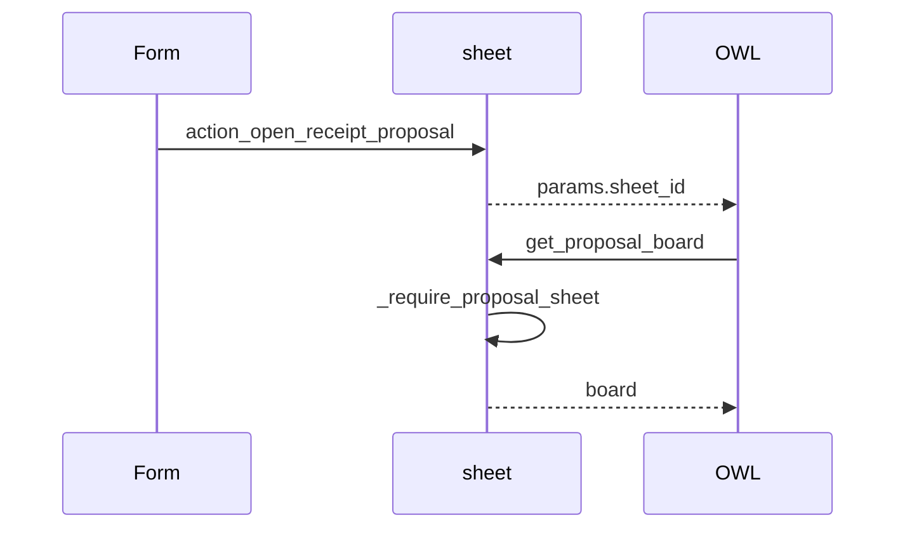
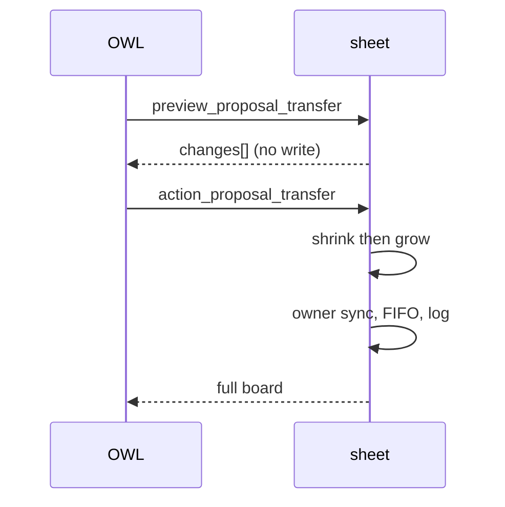
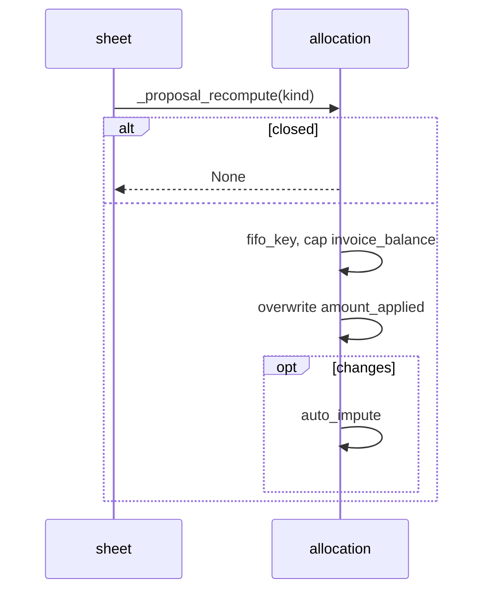
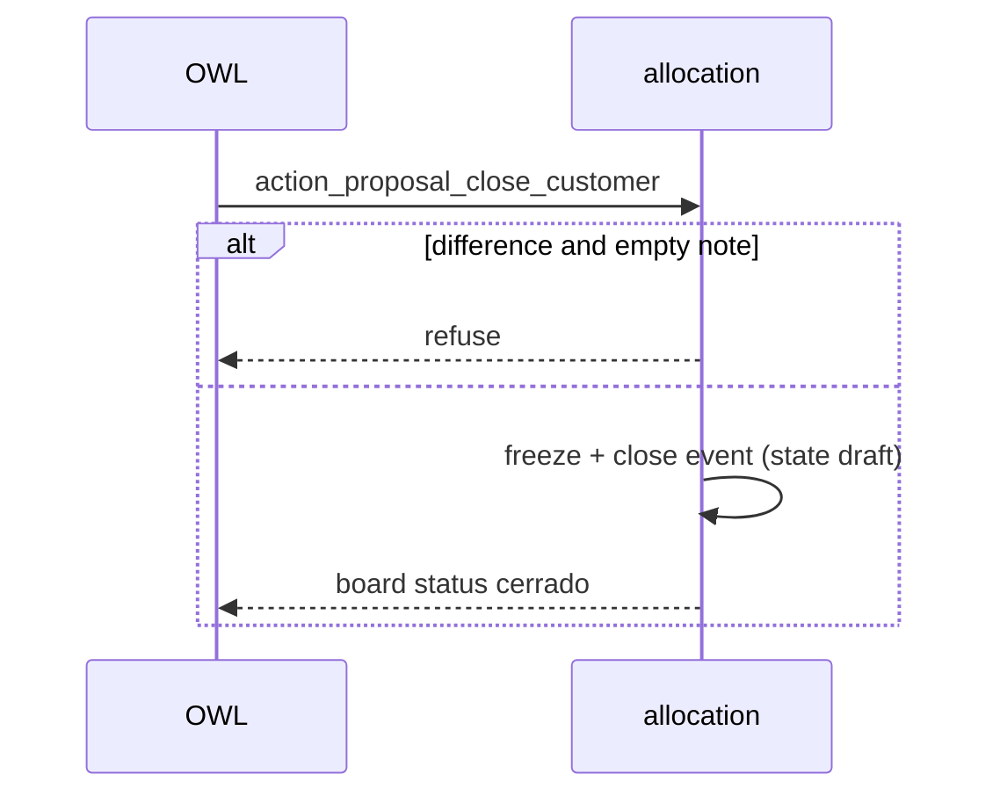

# Design: Collection Receipt Proposal

## Technical Approach

Sibling addon (`depends: ["collection"]`, `19.0.1.0.0`, not an application) writes
imputación into existing `collection.*` between Confirm (`proposal`) and Close. OWL RPCs
re-validate, mutate, re-point owner, FIFO-recompute, log, return the board. Specs:
board, fifo, events, splits. Apply roots stay here; inherit locally — never patch
`collection/`. On-disk files: apply **aligns**, does not recreate blindly.

## Architecture Decisions

| Decision                | Options                                | Tradeoff                                                                                           | Choice                                                                                              |
| ----------------------- | -------------------------------------- | -------------------------------------------------------------------------------------------------- | --------------------------------------------------------------------------------------------------- |
| Schema                  | Parallel tables vs `collection.*`      | Isolation vs duplicate money                                                                       | **Write `collection.*`**                                                                            |
| FIFO                    | JS `fifoPlan` vs Python `@api.private` | Fewer hops vs two engines                                                                          | **Python-only**; JS debounce 250 ms                                                                 |
| Pool                    | Mutate `allocation_id` vs synthetic    | Partner constraint vs extra cards                                                                  | **Synthetic** `pool[]` if free > 0                                                                  |
| Owner                   | Overall largest vs same-customer       | Spec vs `_check_voucher_partners`                                                                  | **Overall largest**; relax partner match when the voucher has a same-sheet share on that allocation |
| `collection_receipt.py` | Reject vs keep                         | Plan omitted; FIFO `amount_applied` trips non-stored `line_ids` totals (`get_depends` extends MRO) | **Keep** explicit totals `depends=`                                                                 |
| Extra RPC               | Spec list vs `preview_proposal_impute` | Surface vs one FIFO                                                                                | **Keep**                                                                                            |

## Data Flow

Form button → client action (no `path`) → OWL `orm` → `_require_proposal_sheet` →
`receipt.value` → receipt (allocation+kind) → `amount_applied` on lines → event →
payload.

### Open board

### Transfer from pool

### FIFO after mutation

### Close customer

## File Changes

Paths relative to this addon. **Align** = already on disk.

| File                                                                        | Action       | Description                                                    |
| --------------------------------------------------------------------------- | ------------ | -------------------------------------------------------------- |
| `models/collection_receipt_value.py`                                        | Align        | Sheet-scope check; sheet-wide cap; card payload                |
| `models/collection_voucher.py`                                              | Align        | Free/assigned/split; labels; pool payload                      |
| `models/collection_allocation.py`                                           | Align        | FIFO, close/reopen, status, column payload                     |
| `models/collection_sheet.py`                                                | Align        | Entry + RPCs; shrink-then-grow                                 |
| `models/collection_receipt_proposal_event.py`                               | Align        | Immutable; gated create; `_proposal_log`                       |
| `models/collection_receipt.py`                                              | Align (keep) | Totals `depends=` for FIFO writes                              |
| `models/__init__.py`                                                        | Align        | Import receipt inherit                                         |
| `static/src/receipt_proposal/*`                                             | Align        | document_review OWL; Spanish; scoped SCSS                      |
| `views/collection_receipt_proposal_views.xml`                               | Align        | Omit `path`; English button after Document Review, before XLSX |
| `security/ir.model.access.csv`                                              | Align        | Event `1,0,1,0` `base.group_user`                              |
| `security/collection_receipt_proposal_security.xml`                         | Align        | Company `ir.rule` `noupdate`                                   |
| `__manifest__.py`                                                           | Align        | `web.assets_backend`                                           |
| `tests/common.py`                                                           | Align        | Mixin; **not** `TestCollectionReceipt`                         |
| `tests/test_receipt_proposal_{fifo,order,split,board,actions,events,ui}.py` | Align        | Plan layout                                                    |
| `openspec/config.yaml`                                                      | Align        | Do not rewrite                                                 |

**Delete:** none. **Never edit:** `collection/`, nebula-agent.

## Interfaces / Contracts

Board `{sheet, columns, pool, events}`:

- **sheet:** `id`, `name`, `state`, `editable`,
  `currency:{id,symbol,position,decimal_places}`
- **columns[]:** `allocation_id`, `partner_id`, `partner_name`, `partner_vat`, `closed`,
  `note`, `closed_by`, `closed_date`, `status`, `circuits`, `cards`, `documents`
- **circuits.invoice|quotation:** `collected`, `applied`, `available`, `total`,
  `pending`
- **cards[]:** `value_id`, `voucher_id`, `voucher_name`, `method`, `reference`, `date`,
  `amount`, `voucher_amount`, `document_kind`, `split_parts`, `free_amount`
- **documents.\*[]:** `line_id`, `number`, `issue_date`, `due_date`, `amount`,
  `balance`, `applied` (FIFO)
- **pool[] synthetic:** `voucher_id`, `voucher_name`, `method`, `reference`, `date`,
  `amount`, `free_amount`, `partner_id`, `partner_name`
- **events[]:** `id`, `allocation_id`, `voucher_id`, `event_type`, `name`,
  `description`, `value_from`, `value_to`, `user_name`, `event_date`

Preview:
`{allocation_id, document_kind, budget, surplus, applied, pending, no_documents, changes:[{line_id,number,date,from,to}], partner_name}`.
Mutations take only the typed amount.

Odoo 19: `models.Constraint`; `@api.private`; `@api.ondelete` (events allow
`collection_sheet_unlinking`); `<list>`; `*.esm.js`; `t-out`; no groups/`sudo()`. Views
English; OWL Spanish; no `i18n/`.

## Testing Strategy

| Layer       | What                                  | Approach                                                                  |
| ----------- | ------------------------------------- | ------------------------------------------------------------------------- |
| Unit        | FIFO, order, splits, RPCs, events, UI | `TransactionCase`; `RED/GREEN:`; `ReceiptProposalCommon`; `--mode=update` |
| Integration | Relaxed collection invariant          | Re-run `collection` `--mode=update`                                       |
| E2E         | None                                  | Static-text UI tests; no HttpCase/tours                                   |

## Threat Matrix

N/A — OWL backend client action + ORM, not
routing/shell/subprocess/VCS/executable/process-integration.

## Migration / Rollout

No migration. Rollback: **uninstall this addon**. Constraints revert; event table drops;
money rows remain. Do not revert `collection`.

## Open Questions

- None blocking. Follow-ups: upstream totals `depends=`; `total_vouchers` after split;
  query-count.
